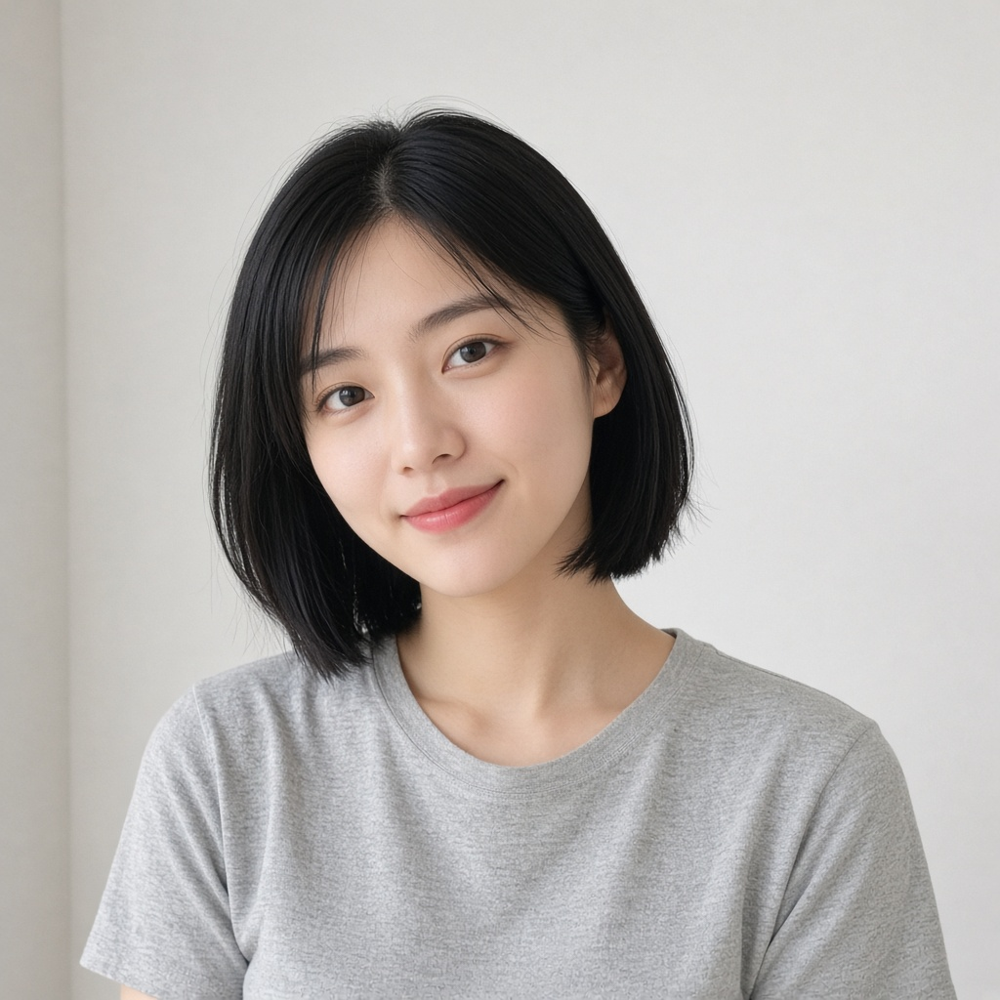
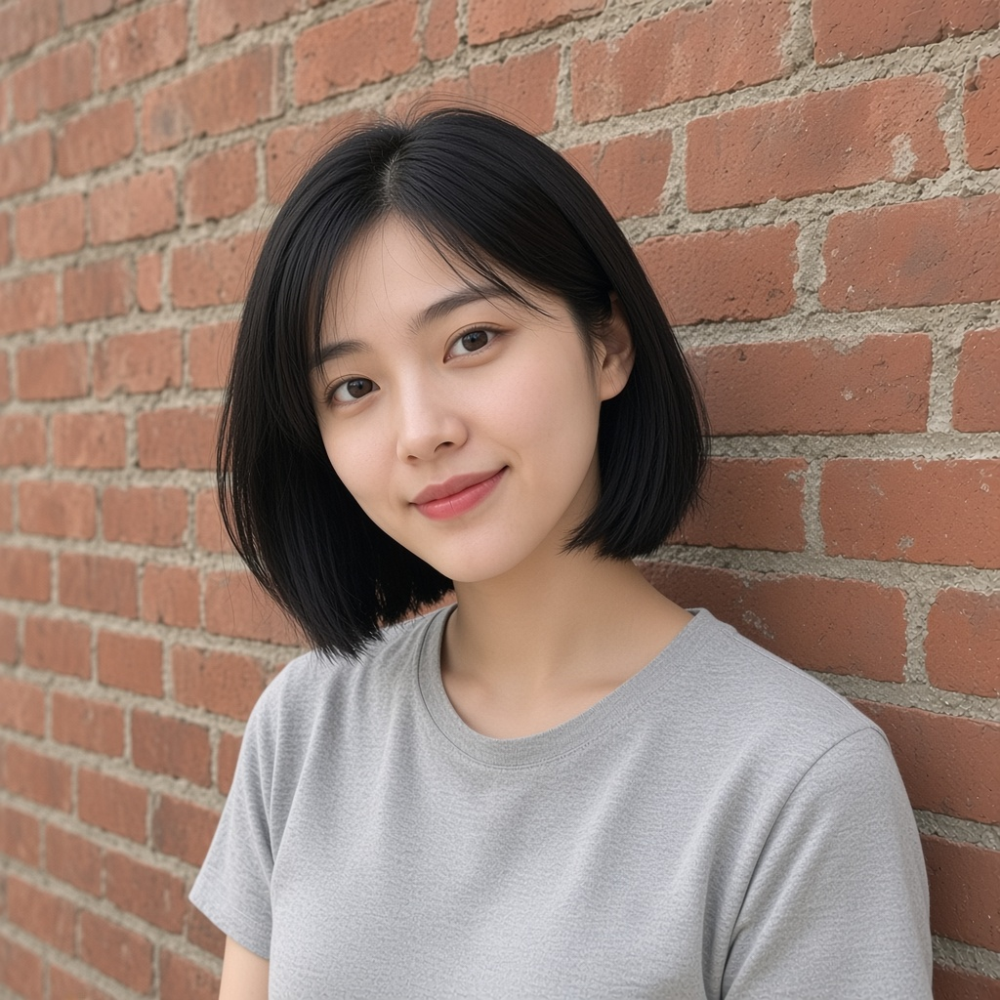
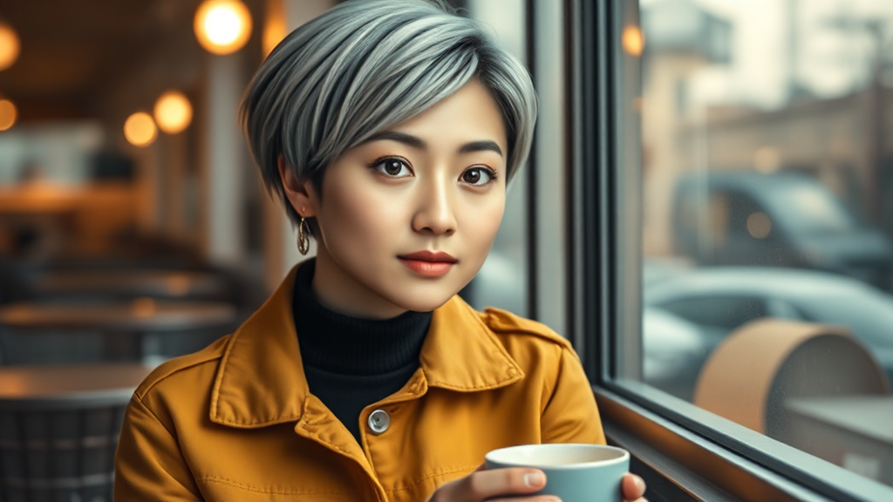

# Examples

Original fictional character for this entry: short black bob, clear face, fictional likeness.

The three PNGs were generated with Grok Image as lookdev boards. [`../demo/demo.mp4`](../demo/demo.mp4) plays those same images. A local locked image comes from loading [`../workflows/character_lock_v1.json`](../workflows/character_lock_v1.json).

| File | Board |
| --- | --- |
| `input_ref.png` | Reference face. Gray t-shirt, plain wall. Copy this file to `ComfyUI/input/input_ref.png` before you load the workflow. |
| `output_dir_a.png` | Direction A. Same character, gray t-shirt, red brick wall, daylight. |
| `output_dir_b.png` | Direction B. Same character, navy hoodie, kitchen table, morning window light. |

## Scene prompts

The identity line shared by the two direction prompts is the `{CHAR}` value in [`../scripts/gen.py`](../scripts/gen.py):

> an original fictional young woman, early 20s, East Asian features, short black bob with a soft center part, gentle smile, clear skin

**Studio** (the positive prompt already on the graph):

> portrait of an East Asian woman, soft studio light, clean background, sharp detail

**Direction A:**

> an original fictional young woman, early 20s, East Asian features, short black bob with a soft center part, gentle smile, clear skin, heather-gray t-shirt, medium close-up, standing against a red brick wall, daylight, realistic photograph

**Direction B:**

> an original fictional young woman, early 20s, East Asian features, short black bob with a soft center part, gentle smile, clear skin, navy hoodie, sitting at a wooden kitchen table with a ceramic coffee mug, morning window light, realistic photograph

Queue each prompt on its own. Keep two directions.
